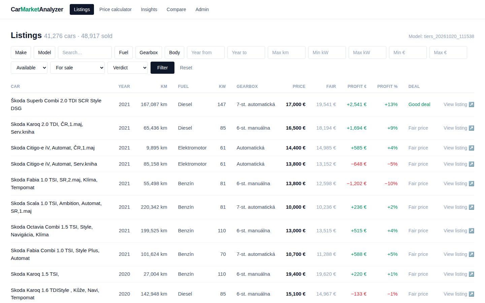
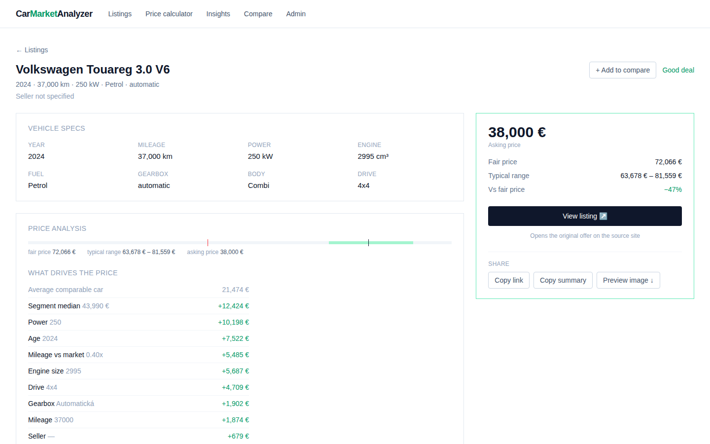
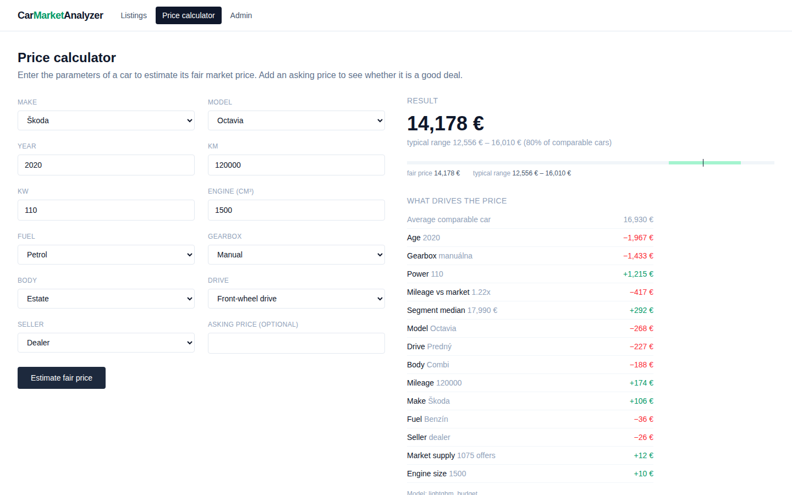

# Car Market Analyzer

Open-source platform for analyzing the used-car market: a scraper collects car
listings, an ML model estimates a **fair price** for each car, and the app shows
which cars are **cheap (good deals)** and which are **overpriced** — including
how much you would earn or lose on the purchase.

**Live demo:** https://car-platform.projects.matejbujnak.com

## Demo


| Listings | Price analysis | Calculator |
|---|---|---|
|  |  |  |

The screenshots and the GIF are captured automatically from the live demo on
every update (see `.github/workflows/demo.yml`).

## What it does

- **Scraper** collects car listings — politely (robots.txt, rate limits,
  checkpoints), on a daily schedule
- **ML fair-price estimate** with a prediction interval → a *deal verdict* per
  car (good deal / fair / overpriced) plus profit in € and %
- **Public demo**: filterable listing feed, car detail with price analysis,
  fair-price calculator
- **Sold detection**: listings that disappear from the source site are marked
  as sold automatically, so the feed only shows live offers
- **Admin**: run scrape jobs, retrain the model, watch metrics and progress

## How it works

```
scraper (daily, polite)  ──►  PostgreSQL  ◄──  ML training (worker job)
                                    │
                            prediction cache
                                    │
                     web UI: fair price · interval · profit
```

- **Model** — LightGBM trained on **log prices**, so the accuracy is relative
  (the same % error on cheap and expensive cars). A Ridge regression serves as
  a sanity baseline.
- **Prediction interval** — split *conformal prediction* on a held-out
  calibration set: a guaranteed ~80% coverage that scales with the price
  (currently ±15.5% of the fair price).
- **Deal score** — `(fair_price − asking_price) / fair_price`; listings priced
  below/above the interval are flagged as *good deal* / *overpriced*, and
  placeholder prices (leasing rates) are flagged as *check price*.
- **Background jobs** — scraping, training and prediction backfill run in a
  worker container fed by a Redis queue; the API stays fast and stateless.

## Tech stack

Python 3.12 · FastAPI · SQLModel + Alembic · PostgreSQL · Redis · LightGBM ·
React 19 · Vite · Tailwind CSS · Docker · GitHub Actions

## Quick start (local)

Requirements: Docker with Docker Compose.

```bash
docker compose -f docker-compose.dev.yml up
```

- Web UI: http://localhost:5173
- API: http://localhost:8000 (interactive docs at `/docs`)
- Postgres: `127.0.0.1:5432` (user/pass/db: `car_platform` / `car_platform` / `car_platform_dev`)
- Redis: `127.0.0.1:6379`

If the default host ports clash with other local services, override them:

```bash
BACKEND_PORT=8001 POSTGRES_PORT=5433 REDIS_PORT=6380 \
  docker compose -f docker-compose.dev.yml up
```

## Deployment

The production stack runs behind a reverse proxy (this project is deployed
with Nginx Proxy Manager) on a shared Docker network.

1. Create the network once: `docker network create home_network`
2. Configure secrets: `cp .env.example .env` and fill in real values
   (`openssl rand -hex 32` for `SECRET_KEY`).
3. Start: `docker compose up -d --build`
   Migrations run automatically on startup and the admin account is seeded
   from `.env`.
4. Point the reverse proxy at the `car-platform-frontend` container (port 80).
   It serves the app and proxies `/api` to the backend, so no CORS setup is
   needed for the browser.

Notes:

- The database and Redis are not published to the host - only the frontend is
  reachable through the reverse proxy.
- Background scraping runs in the `car-platform-worker` container (daily
  schedule, see `SCRAPE_SCHEDULE_HOUR`). Check progress in the admin UI.

## Scraping

The scraper runs in a separate worker container and consumes jobs from a queue.
It is deliberately slow and polite (robots.txt, request limits, delays) to avoid
overloading the source site.

- **Daily crawl** – once a day (default 22:00, see `SCRAPE_SCHEDULE_HOUR`) the
  worker crawls the whole catalogue segment by segment. It runs for hours, saves
  a checkpoint after every segment, and resumes where it stopped after a crash
  or restart. Crowded segments are split by price automatically (the site caps
  results per filter), and a clean full crawl marks listings that disappeared
  from the site as sold.
- **Manual runs** – as admin, queue a run via the API:

```bash
# small run: first N listing pages
curl -X POST "http://localhost:8000/api/admin/scrape?pages=2" \
  -H "Authorization: Bearer $TOKEN"

# full crawl (optionally limited to a few segments for testing)
curl -X POST "http://localhost:8000/api/admin/scrape/full?max_segments=3" \
  -H "Authorization: Bearer $TOKEN"
```

## Project structure

```
backend/            API + background workers (same image, different command)
  app/api/          HTTP endpoints (listings, predictions, admin)
  app/core/         auth, password hashing, rate limiting
  app/db/           models, migrations (Alembic), session
  app/ml/           feature engineering, training, prediction
  app/scraping/     source-site scraper + Redis job queue
frontend/           React SPA (Vite + Tailwind CSS)
scripts/            demo capture (Playwright) and GIF maker
docs/               demo GIF + screenshots (auto-refreshed by CI)
```

## License

[MIT](LICENSE) © 2026 Matej Bujnak

Scraped data is **not** part of this repository and remains subject to the
terms of the source website.
